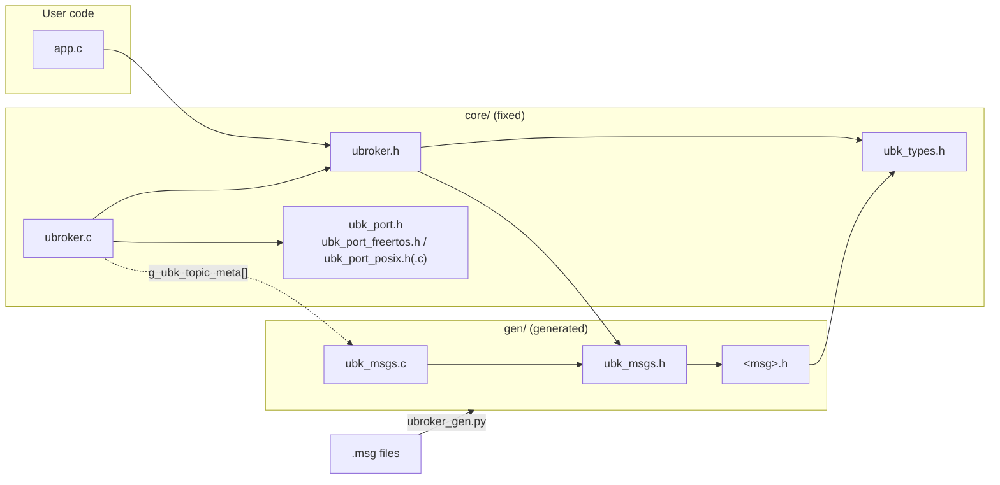
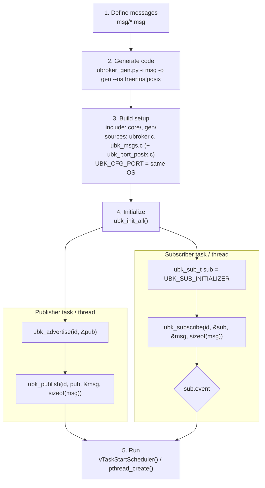

# uBroker

English | [한국어](README_kr.md)

## 1. Overview

uBroker is a **statically allocated Pub/Sub message broker for FreeRTOS and POSIX**, with a **Python generator** that turns `.msg` files into C code.

- No dynamic allocation: one static shared buffer per topic (mailbox, latest value only)
- Unlimited subscribers: the broker keeps no subscriber list (O(1))
- Non-blocking receive with events and lost-message count, single publisher per topic
- Optional per-topic FIFO queue (`# QUEUE N`) for events such as commands
- FreeRTOS (critical sections, ISR publish) or POSIX (pthread mutex per topic), selected by one setting

References: the code structure is based on [**uMsg**](https://github.com/amcolex/umsg), and the message syntax and behavior follow [**PX4 uORB**](https://docs.px4.io/main/en/middleware/uorb.html).

## 2. Folder Structure

```
core/        Fixed broker sources (not generated): ubk_types.h, ubroker.h/.c, OS ports (ubk_port*)
code_gen/    Code generator: ubroker_gen.py
test/        Shared messages (msg/), FreeRTOS examples/tests (freertos/), POSIX examples/tests (posix/)
docs/        Detailed documentation
tools/       Migration tools for existing code: tools/migrate/
ref/         Reference documents (coding rules)
```

## 3. File Dependencies



User code includes only `ubroker.h`. Generated files never include `ubroker.*`. Only `ubroker.c` uses the OS port.

## 4. How to Use



```c
// 4. Initialize
(void)ubk_init_all();                                   // reset every topic's shared memory to defaults (once, before any publish)

// Publisher
ubk_pub_t      pub   = UBK_PUB_INVALID;                 // publisher handle, filled by advertise
weapon_state_t state = WEAPON_STATE_INITIALIZER;        // message variable with all defaults
(void)ubk_advertise(UBK_TOPIC_WEAPON_STATE, &pub);      // become the only publisher of this topic and get the handle
(void)ubk_publish(UBK_TOPIC_WEAPON_STATE, pub, &state, sizeof(state)); // copy state into the topic

// Subscriber
ubk_sub_t      sub    = UBK_SUB_INITIALIZER;            // subscription cursor (one per topic), remembers what was received
weapon_state_t weapon = WEAPON_STATE_INITIALIZER;       // local copy of the message
ubk_subscribe(UBK_TOPIC_WEAPON_STATE, &sub, &weapon, sizeof(weapon)); // copy into weapon only if new; result in sub.event
if (sub.event == UBK_EVT_NEW) { }                       // react to a new message; otherwise weapon keeps its last value
```

Full examples: FreeRTOS [`test/freertos/`](test/freertos), POSIX [`test/posix/`](test/posix). Message syntax: [`docs/msg_syntax.md`](docs/msg_syntax.md)

## 5. Code Generation

```
python code_gen/ubroker_gen.py -i <msg dir> -o <output dir> [--os freertos|posix] [--lang en|ko]
```

`--os` (default `freertos`) must match the build setting `UBK_CFG_PORT` (`UBK_PORT_FREERTOS` / `UBK_PORT_POSIX`). A mismatch stops the build with `#error`.

| Generated file | Contents |
|---|---|
| `<msg>.h` | Struct, constants, `<MSG>_INITIALIZER` |
| `ubk_msgs.h` | Message header bundle, topic IDs `ubk_topic_id_t` |
| `ubk_msgs.c` | Defaults, shared memory, topic info table |

Only changed files are rewritten, and files of deleted `.msg` are removed. Details: [`docs/generator.md`](docs/generator.md)

## 6. Message API

| Function | Description |
|---|---|
| `ubk_init_all()` | Initialize all topics (once at boot) |
| `ubk_init_topic(id)` | Initialize one topic (only before it is published) |
| `ubk_advertise(id, &pub)` | Get publish rights (succeeds once per topic) |
| `ubk_publish(id, pub, &msg, size)` | Publish from a task |
| `ubk_publish_from_isr(id, pub, &msg, size)` | Publish from an ISR (FreeRTOS only) |
| `ubk_subscribe(id, &sub, &msg, size)` | Copy the next message (oldest first); result in `sub.event`, `sub.n_lost`, `sub.n_pending` |

| `sub.event` | Meaning |
|---|---|
| `UBK_EVT_NO_DATA` | Topic not published yet |
| `UBK_EVT_NO_NEW` | No new message (previous value kept) |
| `UBK_EVT_NEW` | New message copied |
| `UBK_EVT_NEW_LOST` | New message copied, `n_lost` messages missed |
| `UBK_EVT_ERR_*` | Error (`NULL`, `SIZE`, `TOPIC`, `OS`) |

Details: [`docs/api.md`](docs/api.md) · Configuration and limits: [`docs/configuration.md`](docs/configuration.md) · Tests: [`docs/testing.md`](docs/testing.md) · Migrating existing code: [`docs/migration.md`](docs/migration.md) · Design: [`uBroker_design.md`](uBroker_design.md) (Korean)

---

MIT License. See [`LICENSE`](LICENSE).
