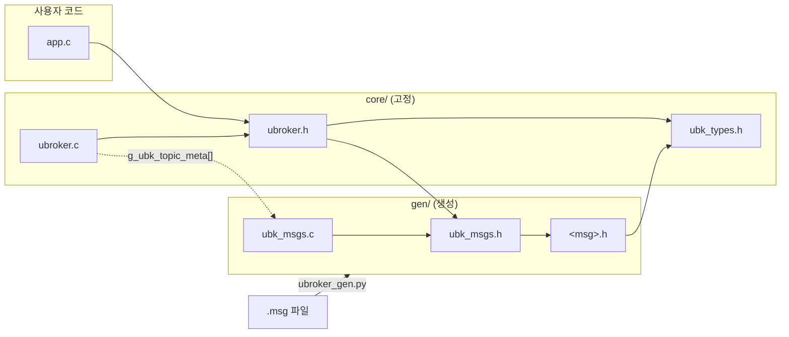
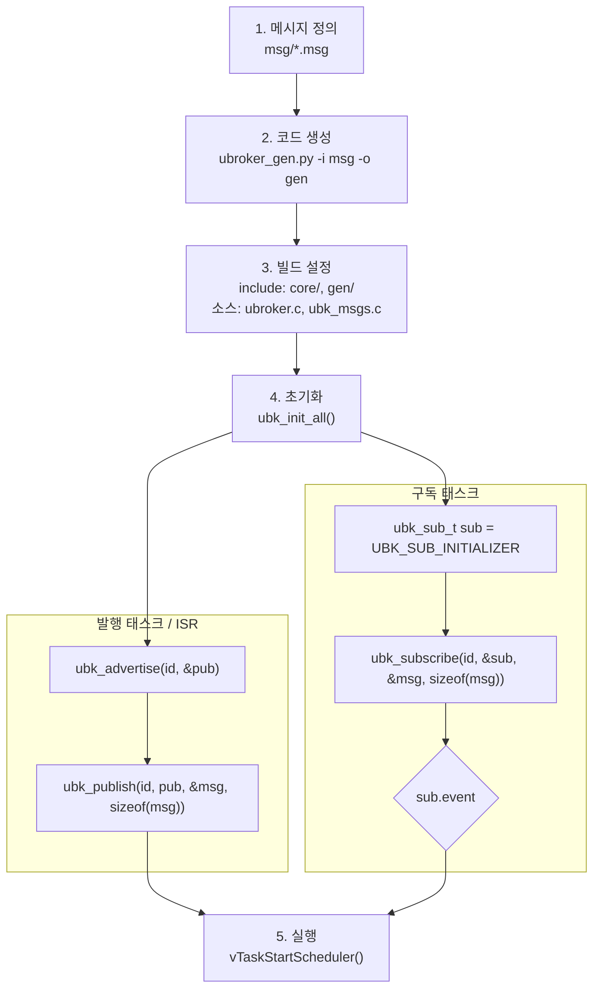

# uBroker

[English](README.md) | 한국어

## 1. 개요

uBroker는 FreeRTOS용 **정적 할당 Pub/Sub 메시지 브로커**이며, `.msg` 파일로 C 코드를 만드는 **Python 생성기**를 함께 제공합니다.

- 동적 할당 없음: 토픽마다 정적 공유 메모리 1개 (Mailbox, 최신값만 유지)
- 구독자 수 무제한: 브로커가 구독자 목록을 갖지 않음 (O(1))
- Non-blocking 수신(이벤트, 놓친 횟수), ISR 발행, 토픽당 발행자 1개

참고: 코드 구조는 **uMsg**를, 메시지 문법과 동작 방식은 **PX4 uORB**를 참고했습니다.

## 2. 폴더 구조

```
core/        브로커 고정 소스 (생성하지 않음): ubk_types.h, ubroker.h, ubroker.c
code_gen/    코드 생성기: ubroker_gen.py
test/        예제 메시지(msg/), 생성 코드(gen/), 예제, 호스트 테스트(host/)
docs/        상세 문서
ref/         참고 문서 (코딩 규칙)
```

## 3. 파일 호출 구조



사용자 코드는 `ubroker.h`만 include합니다. 생성 파일은 `ubroker.*`를 참조하지 않습니다.

## 4. 사용 방법



```c
// 4. 초기화
(void)ubk_init_all();                                   // 모든 토픽의 공유 메모리를 기본값으로 초기화 (발행 전에 1회)

// 발행
ubk_pub_t      pub   = UBK_PUB_INVALID;                 // 발행 핸들 (advertise 가 채워 줌)
weapon_state_t state = WEAPON_STATE_INITIALIZER;        // 기본값으로 초기화한 메시지 변수
(void)ubk_advertise(UBK_TOPIC_WEAPON_STATE, &pub);      // 이 토픽의 유일한 발행자가 되고 발행 핸들을 받음
(void)ubk_publish(UBK_TOPIC_WEAPON_STATE, pub, &state, sizeof(state)); // state 를 토픽에 복사 (발행)

// 구독
ubk_sub_t      sub    = UBK_SUB_INITIALIZER;            // 구독 커서 (토픽마다 1개), 어디까지 받았는지 기억
weapon_state_t weapon = WEAPON_STATE_INITIALIZER;       // 받은 메시지를 담을 로컬 변수
ubk_subscribe(UBK_TOPIC_WEAPON_STATE, &sub, &weapon, sizeof(weapon)); // 새 메시지면 weapon 에 복사, 결과는 sub.event
if (sub.event == UBK_EVT_NEW) { }                       // 새 메시지일 때 처리, 아니면 weapon 은 직전 값 유지
```

전체 예제: [`test/pub.c`](test/pub.c), [`test/sub.c`](test/sub.c) · 메시지 문법: [`docs/msg_syntax_kr.md`](docs/msg_syntax_kr.md)

## 5. 코드 생성 방법

```
python code_gen/ubroker_gen.py -i <msg 폴더> -o <출력 폴더> [--lang en|ko]
```

| 생성 파일 | 내용 |
|---|---|
| `<msg>.h` | 구조체, 상수, `<MSG>_INITIALIZER` |
| `ubk_msgs.h` | 메시지 헤더 묶음, 토픽 ID `ubk_topic_id_t` |
| `ubk_msgs.c` | 기본값, 공유 메모리, 토픽 정보 테이블 |

바뀐 파일만 다시 쓰고, 삭제된 `.msg`의 생성 파일은 지웁니다. 상세: [`docs/generator_kr.md`](docs/generator_kr.md)

## 6. 메시지 사용 API

| 함수 | 설명 |
|---|---|
| `ubk_init_all()` | 모든 토픽 초기화 (부팅 시 1회) |
| `ubk_init_topic(id)` | 토픽 하나 초기화 (발행 전에만 가능) |
| `ubk_advertise(id, &pub)` | 발행 권한 획득 (토픽당 1회만 성공) |
| `ubk_publish(id, pub, &msg, size)` | 태스크에서 발행 |
| `ubk_publish_from_isr(id, pub, &msg, size)` | ISR에서 발행 |
| `ubk_subscribe(id, &sub, &msg, size)` | 새 메시지면 복사, 결과는 `sub.event` / `sub.n_lost` |

| `sub.event` | 의미 |
|---|---|
| `UBK_EVT_NO_DATA` | 아직 발행되지 않은 토픽 |
| `UBK_EVT_NO_NEW` | 새 메시지 없음 (직전 값 유지) |
| `UBK_EVT_NEW` | 새 메시지 복사됨 |
| `UBK_EVT_NEW_LOST` | 새 메시지 복사됨, 중간에 `n_lost`개 놓침 |
| `UBK_EVT_ERR_*` | 오류 (`NULL`, `SIZE`, `TOPIC`) |

상세: [`docs/api_kr.md`](docs/api_kr.md) · 설정과 한계: [`docs/configuration_kr.md`](docs/configuration_kr.md) · 테스트: [`docs/testing_kr.md`](docs/testing_kr.md) · 설계: [`uBroker_design.md`](uBroker_design.md)

---

MIT License. [`LICENSE`](LICENSE) 참고.
